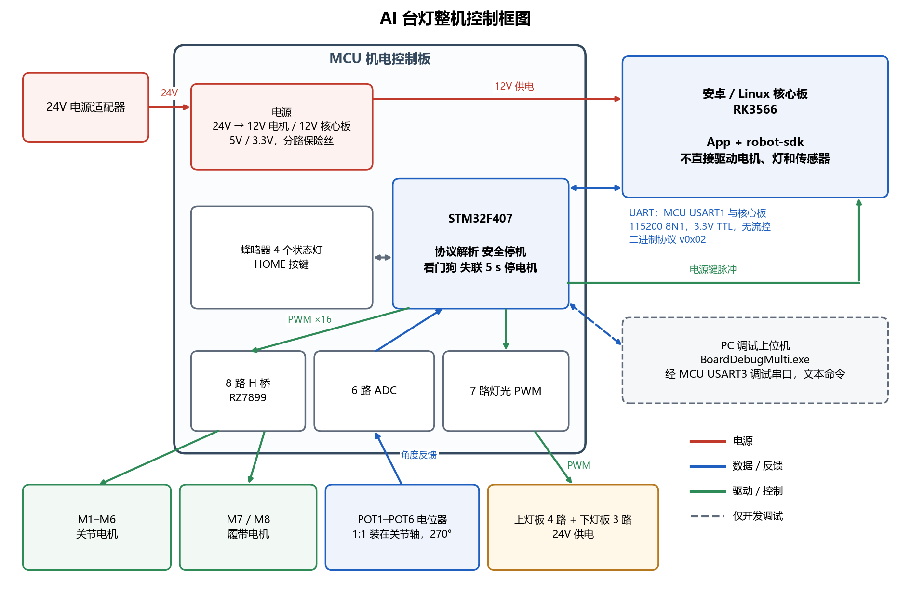

# MCU 控制板能力与接口说明（回复软件组）

阅读指引：第 1 节是结论，第 4、5 节是安卓端对接要用的能力对照和能力声明，第 7 节是原来待商定问题的现状，其余各节备查。

2026-11-02 更新，对应固件提交 `032cf91`，固件源码在 `MCU/software`。协议以 SDK 0.5.0 的《MCU扩展协议与安全控制.md》为准，在本地仓库的 `Linux/AILight/docs` 目录下。

## 1. 结论

- 最终机器人配置 MCU 控制板：自研 [STM32F407VGT6](https://www.st.com/en/microcontrollers-microprocessors/stm32f407vg.html) 机电控制板 V1.0，已打样、焊接并完成上电调试。安卓核心板 [RK3566](https://so.szlcsc.com/global.html?k=RK3566) 不直接驱动任何电机和灯光，也不直接读电位器；全部执行器和传感器都接在 MCU 板上，核心板通过一路 UART 下发命令。
- 核心板的 12V 电源由 MCU 板提供，MCU 还可以通过电源键脉冲控制核心板开关机。
- 安卓协议现在开放：基础命令 PING、GET_STATUS、SET_LIGHT、SET_MOTION 全部动作；扩展命令 0x31 到 0x37，即关节定位、扩展状态查询、关节回原点、分区灯、蜂鸣器、指示灯。只有 0x30 灯光模式和 0x38 软关机还没有实现。
- 安卓端要按 extension-v2 构造能力描述才能用扩展命令，声明内容见第 5 节。默认的 `LEGACY_V2` 只会用基础命令。
- 与真实安卓核心板之间的串口联调还没有完成，扩展命令只在电脑上用单元测试验证过。

## 2. 整机框图

可编辑源文件为同目录的 `整机框图.drawio`，可用 draw.io 桌面版、网页版 diagrams.net 或 VS Code 的 Draw.io Integration 插件打开，改完导出 PNG 覆盖 `整机框图.png` 即可。

## 3. 与核心板的连接

| 项目 | 内容 |
|---|---|
| [串口](software/Core/Src/usart.c) | MCU USART1：PA9 为 TX，PA10 为 RX，各串 47Ω。板上接口为 U5（4P，UART 与电源脉冲）和 U36 排针，线序以原理图为准 |
| [电气](hardware/引脚位置_镜像_v2.png) | 3.3V TTL，115200，8N1，无流控 |
| [协议](software/Protocol/Inc/mcu_protocol.h) | 与 SDK 协议的 0x02 版一致：`A5 5A` 帧头，CRC16/MODBUS，多字节小端 |
| [供电](hardware/已知硬件问题.md) | 板上 24V 转 12V 模块 U19（8A）给核心板供 12V，支路带保险丝和 10mΩ 电流采样 |
| [电源键](https://so.szlcsc.com/global.html?k=2N7002) | PB12 经 2N7002 开漏输出到 U5.4，接核心板电源键；核心板一侧的电平和脉宽要求还需核对 |

## 4. 能力对照

“硬件”指控制板上实际具备的功能；“安卓协议”指当前固件在安卓模式下通过 USART1 开放的功能。

| 功能 | 硬件 | 安卓协议 | 说明 |
|---|---|---|---|
| [灯光](software/App/src/app_main.c) | 7 路独立 PWM：上灯板 4 路、下灯板 3 路，24V 灯板，千分比调光 | `SET_LIGHT` 七路统一开关和亮度；`SET_LIGHT_ZONE` 0x35 单独设一路，分区 ID 1 到 4 为上灯板 UP1 到 UP4，5 到 7 为下灯板 DOWN1 到 DOWN3 | `SET_LIGHT` 会覆盖之前的分区设置。`STATUS` 的灯光开关为任意一路亮着即为 1，亮度为最近一次 `SET_LIGHT` 的值。灯光模式 0x30 未实现 |
| [移动](software/App/src/chassis.c) | M7、M8 两路履带电机，左 M7 右 M8 | `SET_MOTION` 全部动作：前进、后退、原地左转、原地右转、STOP | 速度 0 到 100 乘 10 为 PWM 千分比，下限为起转值 10%，上限 80%；开环，`STATUS` 回读最近一次成功应用的动作和速度 |
| [关节](software/App/src/joint_control.c) | M1 到 M6 六路关节电机，各配一个电位器，1:1 装在关节轴上，行程 270° | `SET_ARM_POSITION` 0x31、`HOME_ARM` 0x34、`GET_EXTENDED_STATUS` 0x32 | 关节 ID 1 到 6 对应 M1 到 M6。六个关节可以同时运动，同一关节的新目标替代旧目标。到位容差默认 2°。默认的比例式下速度参数只记录、不限速；试验中的轨迹式把它作为速度上限。未标定的关节回 `INVALID_COMMAND` |
| [蜂鸣器](software/Config/app_config.h) | 被动蜂鸣器，TIM13 PWM 驱动 | `SET_BUZZER` 0x36：图案 0 关、1 长鸣、2 慢响、3 快响，音量 0 到 100 | 图案一直保持到下一条命令；音量换算成 2.7kHz PWM 的占空比 1% 到 50%，和响度不是线性关系 |
| [指示灯](software/BSP/Inc/bsp_led.h) | 4 个状态灯：STATE、COMM、ACT、ERROR | `SET_INDICATOR` 0x37：ID 1 为 STATE，2 为 ACT | COMM 由固件用来闪烁提示通信，ERROR 用来报初始化失败，不开放 |
| [STOP](software/App/src/app_main.c) | 无 | 停止底盘和全部关节、取消目标，再清除原因已消失的故障 | 灯光、蜂鸣器、指示灯保持 |
| [失联保护](software/Config/app_config.h) | 无 | 连续 5 秒没有收到任何合法帧即停止全部电机并关掉蜂鸣器 | SDK 需要至少每 5 秒发一帧，PING 或 GET_STATUS 都可以 |
| [故障位](software/App/inc/joint_control.h) | 无 | `STATUS` 的 `fault_flags` 为各关节故障与底盘故障按位或，位定义与 SDK 文档一致；`EXTENDED_STATUS` 报单关节故障 | 有故障时拒绝非 STOP 的移动和关节动作；灯光、蜂鸣器、指示灯和查询不受限制 |
| [HOME 按键](software/BSP/Inc/bsp_key.h) | 有，MCU 侧用作急停 | 不上报 | 按下立即停止全部电机；SDK 文档也注明协议里没有约定物理 HOME 输入 |
| [软关机](software/BSP/Inc/bsp_linux_power.h) | 有电源键脉冲 | 0x38 未实现 | 涉及核心板电源时序，需要单独商量 |
| [未知命令](software/Protocol/Src/mcu_command.c) | 无 | 要求 ACK 的命令回 `INVALID_COMMAND`；不要求 ACK 的直接丢弃 | 后者在 SDK 侧会表现为 STATE_TIMEOUT |

## 5. 安卓端的能力声明

在 `SampleMcuConfiguration.kt` 的 `capabilities()` 里改用 `verifiedRevision2(...)`，按下表填写。

| 字段 | 取值 | 说明 |
|---|---|---|
| [extensionRevision](software/Protocol/Src/mcu_command.c) | 2 | 允许非零到位容差 |
| [joints](software/Config/app_config.h) | 1 到 6 | 每个关节的 `minPositionMilliDegrees`、`maxPositionMilliDegrees` 要用调试上位机的 `jlim` 在实物上测出来再填；`maxSpeedMilliDegreesPerSecond` 也要实测 |
| [homePositionMilliDegrees](software/Config/app_config.h) | 135000 | 六个关节都是 135°，见 `MCU_ARM_HOME_MDEG`，前提是关节按电位器转角 0 到 270° 标定 |
| [positionToleranceMilliDegrees](software/Config/app_config.h) | 2000 | 与固件默认容差一致；某个关节在调试模式下改过容差时要同步 |
| [lightZoneIds](software/App/src/app_main.c) | 1 到 7 | 分区对应关系见第 4 节 |
| [buzzerPatternIds](software/Config/app_config.h) | 0 到 3 | 见 `MCU_BUZZER_PATTERNS` |
| [indicatorIds](software/App/src/app_main.c) | 1、2 | STATE、ACT |
| [lightModes](software/Protocol/Src/mcu_command.c) | 空 | 0x30 未实现 |
| [supportsSoftShutdown](software/Protocol/Src/mcu_command.c) | false | 0x38 未实现 |

## 6. 固件的两种工作模式

固件在编译时用 `APP_MODE` 选择工作模式，两种模式只能二选一：

| 模式 | 用途 | 通信 |
|---|---|---|
| [APP_MODE_DEBUG](software/App/src/debug_console.c) | 开发、板级测试、关节标定，开放全部功能 | USART3 文本命令，PC 上位机 `BoardDebugMulti.exe` |
| [APP_MODE_ANDROID](software/App/src/app_main.c) | 最终机器人 | USART1 二进制协议，与核心板通信；USART3 只输出日志 |

关节标定和控制参数保存在片内 Flash 的扇区 10 和 11，正常重新烧录不会清除，整片擦除会清除。流程是先烧调试模式固件，用上位机完成标定和限位设置，再烧安卓模式固件，标定参数保留。烧录方法见 `MCU/software/烧录说明.md`。

## 7. 原待商定问题的现状

| 问题 | 现状 |
|---|---|
| [到位判定](software/Config/app_config.h) | 已解决。SDK extension-v2 允许按关节声明容差，固件默认 2°，回读的目标值始终是原始命令目标，不会用实际位置冒充 |
| [速度参数](software/App/src/app_main.c) | 默认的比例式只记录、不限速，`EXTENDED_STATUS` 的目标速度在运动中报请求值，停止后为 0。SDK 文档要求目标速度报“当前运行目标速度”，不能整段都填请求值，比例式这一点不符合。试验中的轨迹式把速度参数作为上限，目标速度报轨迹上的参考速度，符合要求 |
| [HOME_ARM](software/Config/app_config.h) | 已约定为 135°，即电位器行程中点 |
| [能力描述的数值](software/App/src/joint_control.c) | 待实测。每个关节的允许范围和最大速度要在实物上测，硬件这边提供 |
| [多关节同时运动](software/App/src/joint_control.c) | 已支持，六个关节可以同时运动 |
| [fault_flags 位定义](software/App/inc/joint_control.h) | 已按 SDK 文档实现：bit0 停滞，bit1 定位超时，bit2 方向错误，bit3 超出允许范围，bit4 电位器失效，bit5 驱动失败，bit6 底盘故障 |
| [物理 HOME 键与标定状态上报](software/BSP/Inc/bsp_key.h) | 仍未上报，需要的话再扩展协议 |
| [重复定位精度](software/App/src/joint_control.c) | 关节停在容差带内的任意位置，到位后不再保持，重复定位的分散程度大致等于容差带宽度。在调电机时评估缩小容差、单方向逼近或到位后保持 |

## 8. 验证状态与下一步

已验证：

- MCU 板上电；七路灯光 PWM、六路 ADC、蜂鸣器、状态灯、HOME 键，见 `MCU/hardware/已知硬件问题.md`；
- 电机已接实际电机测试转动，关节闭环和标定在调试模式下由 PC 上位机测试；
- 协议层和命令层的电脑端单元测试，包括全部已实现的扩展命令，CRC 使用 SDK 文档中的示例帧作为测试向量。

未验证：

- 与安卓核心板的 UART 实物联调，以及安卓模式下的扩展命令；
- 蜂鸣器音量档位的实际听感；
- 电源键脉冲接入核心板，目前只在未接核心板时看过波形。

下一步：

1. 用调试模式测出六个关节的允许范围和最大速度，填进第 5 节的能力声明；
2. 安卓端按第 5 节重新打包 SDK 0.5.0 的 APK，约一次联调，依次验证基础命令、失联停机、灯光分区、蜂鸣器、指示灯和关节定位；
3. 再商量 0x30 灯光模式和 0x38 软关机是否需要。
