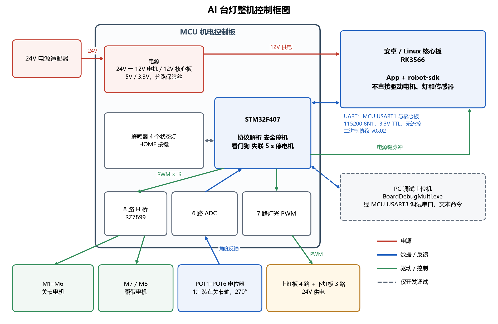

# MCU 控制板能力与接口说明（回复软件组）

2026-10-22，对应固件提交 `fa164ae`（`MCU/software/test_bringup`）。本文回答两个问题：最终机器人是否配置 MCU 控制板；实际固件支持哪些灯光、移动和关节能力。

## 1. 结论

- 最终机器人配置 MCU 控制板：自研 STM32F407 机电控制板 V1.0，已打样、焊接并完成上电调试。安卓核心板（RK3566）不直接驱动任何电机、灯光，也不直接读取电位器，全部执行器和传感器都接在 MCU 板上，核心板通过一路 UART 下发命令。
- 核心板的 12V 电源由 MCU 板提供；MCU 还可以通过“电源键脉冲”控制核心板开关机。
- 当前固件在安卓协议下只开放：PING、状态查询、灯光总开关和亮度、STOP。除 STOP 以外的移动动作、关节控制，以及扩展协议 0x30～0x38 都还没有实现。
- SDK 构造控制器时请不要声明任何扩展能力。默认的 `LEGACY_V2` 里，FORWARD / BACKWARD / TURN_LEFT / TURN_RIGHT 会被 MCU 以 `INVALID_COMMAND` 拒绝，目前只有 STOP 可用。
- 与真实安卓核心板之间的串口联调**尚未进行**，这一点与样例说明一致。

## 2. 整机框图

可编辑源文件为同目录的 `整机框图.drawio`，可用 draw.io 桌面版、网页版 diagrams.net 或 VS Code 的 Draw.io Integration 插件打开，改完导出 PNG 覆盖 `整机框图.png` 即可。

## 3. 与核心板的连接

| 项目 | 内容 |
|---|---|
| 串口 | MCU USART1：PA9 = TX，PA10 = RX，各串 47Ω。板上接口为 U5（4P，UART 与电源脉冲）和 U36 排针，线序以原理图为准 |
| 电气 | 3.3V TTL，115200，8N1，无流控 |
| 协议 | 与 SDK《MCU通信协议.md》的 0x02 版一致：`A5 5A` 帧头，CRC16/MODBUS，多字节小端 |
| 供电 | 板上 24V→12V 模块（U19，8A）给核心板供 12V，支路带保险丝和 10mΩ 电流采样 |
| 电源键 | PB12 经 2N7002 开漏输出到 U5.4，接核心板电源键；核心板一侧的电平和脉宽要求还需核对 |

## 4. 能力对照

“硬件”指控制板上实际具备的功能；“安卓协议”指当前固件在安卓模式下通过 USART1 开放的功能。

| 功能 | 硬件 | 安卓协议（当前固件） | 说明 |
|---|---|---|---|
| 灯光 | 7 路独立 PWM：上灯板 4 路、下灯板 3 路，24V 灯板，千分比调光 | `SET_LIGHT`：总开关 + 亮度 0～100%，7 路统一亮度；`STATUS` 回读实际开关和亮度 | 灯光模式（0x30）、分区灯（0x35）未实现；硬件支持逐路控制，需要约定分区 ID |
| 移动 | M7 / M8 两路履带电机，双向 PWM，占空比 50～80% | `SET_MOTION` 只接受 STOP；其他动作返回 `INVALID_COMMAND`；`STATUS` 中的动作恒为 STOP、速度恒为 0 | 需要先定动作映射（前进、后退、转向分别对应哪路电机的正反转）和速度的含义（电机低于 50% 占空比转不动） |
| 关节 | M1～M6 六路关节电机，各配一个电位器，1:1 装在关节轴上，行程 270° | 未接入（0x31～0x34 未实现） | 固件里的闭环定位和标定（标定结果存片内 Flash）已在调试模式下实现，接入前需要先商定第 6 节的问题 |
| STOP | — | 停止全部 8 路电机（含关节），灯光保持 | 符合 SDK“STOP 须停止底盘和全部关节”的要求 |
| 失联保护 | — | 连续 5 秒没有收到任何合法帧即停止全部电机 | SDK 需要至少每 5 秒发一帧（PING 或 GET_STATUS） |
| 状态与故障 | — | `STATUS` 16 字节：灯光实际值、运行秒数、协议错误计数；`fault_flags` 目前恒为 0 | 电机和关节故障还没有汇总到 `fault_flags` |
| 蜂鸣器、4 个状态灯 | 有 | 未开放（0x36、0x37 未实现） | |
| HOME 按键 | 有，MCU 侧用作急停 | 不上报 | SDK 文档也注明协议里没有约定物理 HOME 输入 |
| 软关机 | 有电源键脉冲 | 0x38 未实现 | |
| 未知命令 | — | 要求 ACK 的命令回 `INVALID_COMMAND`；不要求 ACK 的命令（如 0x32 查询）直接丢弃 | 后者在 SDK 侧会表现为 STATE_TIMEOUT |

## 5. 固件的两种工作模式

固件在编译时用 `APP_MODE` 选择工作模式，目前两种模式只能二选一：

| 模式 | 用途 | 通信 |
|---|---|---|
| `APP_MODE_DEBUG` | 开发、板级测试、关节标定，开放全部功能 | USART3 文本命令，PC 上位机 `BoardDebugMulti.exe` |
| `APP_MODE_ANDROID` | 最终机器人 | USART1 二进制协议，与核心板通信；USART3 只输出日志 |

关节标定保存在片内 Flash 的独立扇区，用调试器重新下载固件不会清除。计划的流程是：先在调试模式下用上位机完成标定，再烧写安卓模式固件，标定参数保留。不过安卓模式目前还没有接入关节控制。

## 6. 需要和软件组商定的问题（关节）

1. **到位判定**：SDK 要求实际位置与目标位置按毫度**严格相等**、速度为 0 才算 APPLIED。MCU 的关节控制是“全速接近加短脉冲点动”，只能停在容差内（默认 2°），不可能严格相等，MCU 也不会把实际位置谎报成目标值。建议在协议里增加容差，或在 EXTENDED_STATUS 中增加“已到位”状态位。
2. **速度参数**：电机低于 50% 占空比转不动，无法按“毫度/秒”精确调速。建议速度只作上限或档位，或在能力描述中注明忽略。
3. **HOME_ARM**：需要约定每个关节的原点角度，以标定后的关节角度为准。
4. **能力描述的数值**：每个关节的最小/最大位置、最大速度需要实物测量，由硬件这边提供。固件已支持按关节设置允许运动范围。
5. **多关节同时运动**：MCU 目前一次只控制一个关节运动，第二个命令会回 BUSY；需要并发的话要改固件。
6. **`fault_flags` 位定义**：需要定义电机、关节、电源等故障各占哪一位。
7. **物理 HOME 键、标定状态上报**：SDK 中预留为 UNKNOWN；需要的话需扩展协议。

## 7. 验证状态与下一步

- **已验证**：
  - MCU 板上电；
  - 七路灯光 PWM、六路 ADC、蜂鸣器、状态灯、HOME 键（见 `MCU/hardware/已知硬件问题.md`）；
  - 电机已接实际电机测试转动（调试模式下由 PC 上位机控制）；
  - 协议层与命令层的 PC 端自测，CRC 使用 SDK 文档中的示例帧作为测试向量。
- **未验证**：
  - 与安卓核心板的 UART 实物联调；
  - 电源键脉冲接入核心板（目前只在未接核心板时看过波形）；
  - 安卓模式整体运行。
- **建议的下一步**：
  1. 约一次联调：用 SDK 的 0x02 基础命令（PING、GET_STATUS、SET_LIGHT、STOP），在实物上验证 CRC、ACK、状态回读和 5 秒失联停机；
  2. 商定第 6 节的问题后，固件再实现关节相关的扩展命令。
