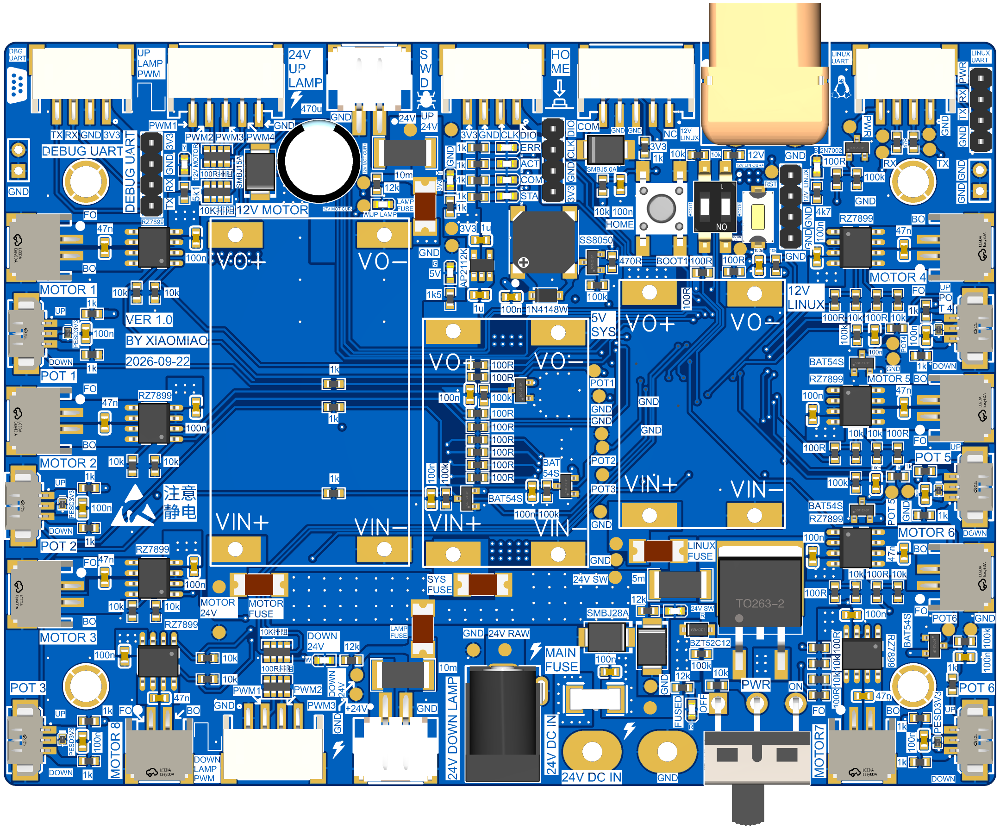
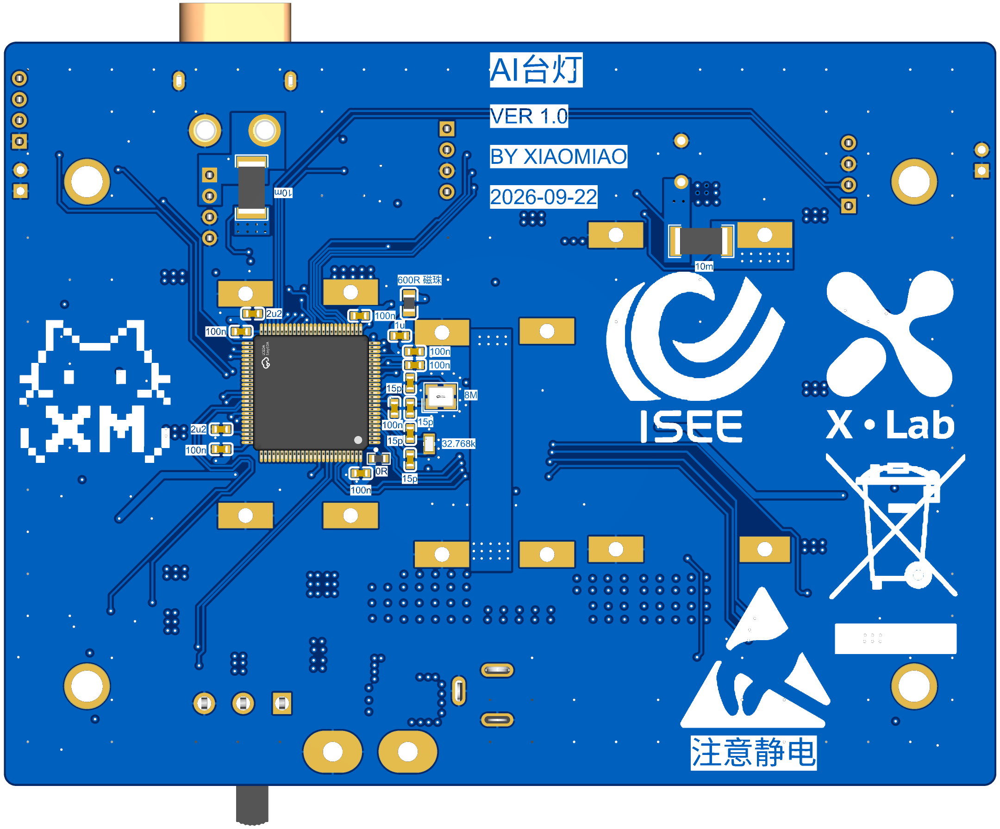
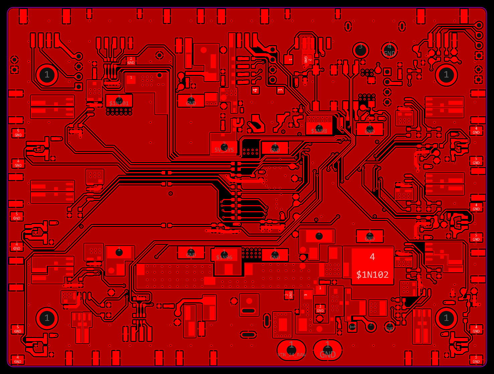
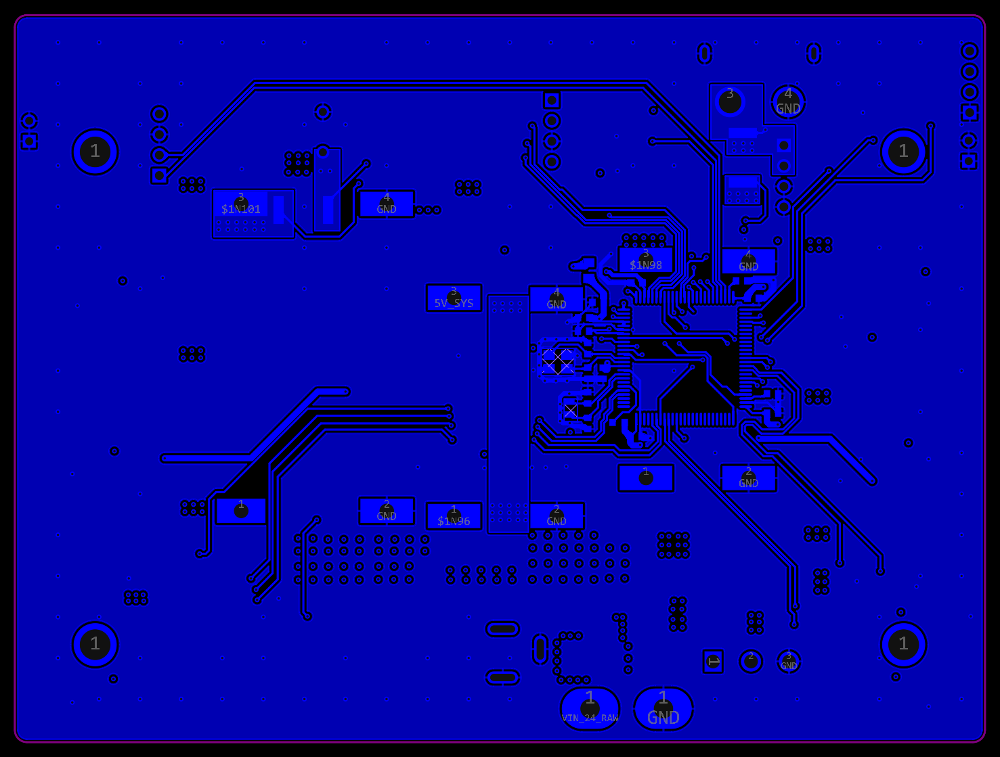
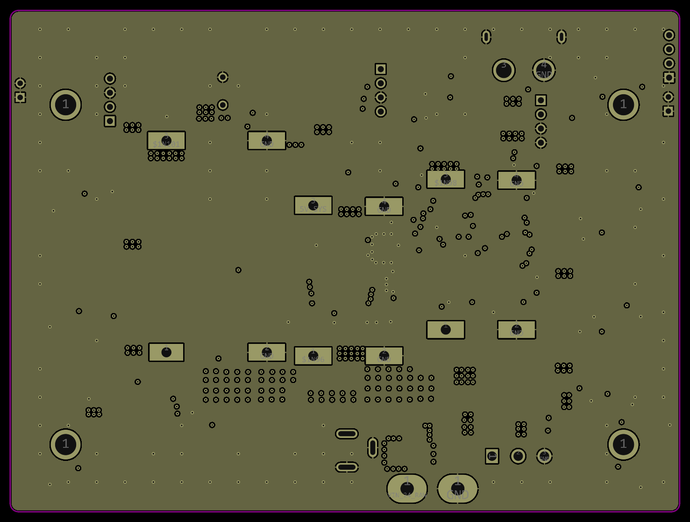
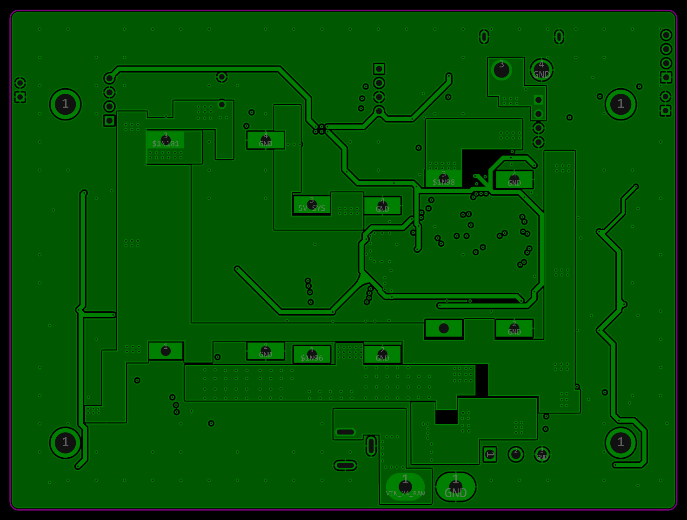

# AI 台灯：电机与灯光主控板、固件与调试工具

X·Lab 台灯形态教育陪伴机器人工程样机的机电控制部分。本仓库包含 STM32F407 主控板的硬件设计、FreeRTOS 固件、PC 端调试上位机，以及早期的电源板和电机驱动实验代码。主控板 V1.0 已打样、焊接并完成上电调试，固件在实板上运行。

Motor and lighting controller for a lamp-shaped companion robot prototype: a 4-layer STM32F407 board driving 8 DC motors with potentiometer feedback and 7 lamp PWM channels, a FreeRTOS firmware with a binary UART protocol to the Linux/Android main board, and a Python debug tool. Designed in EasyEDA Pro.

## 主控板

四层板，STM32F407VGT6 贴装于底层，所有接线端子和调试接口放在顶层，便于柜内接线。

| 部分 | 内容 |
|---|---|
| 电源 | 24V DC 输入，保险丝、P-MOS 反接保护与总开关；板载 12V 电机、12V Linux、5V 系统三路降压模块，AP2112K 3.3V LDO；各支路独立保险丝；24V 母线 TVS |
| 电机 | 8 路 RZ7899 H 桥直流电机驱动，每路双向 PWM，接口带 PESD 保护 |
| 反馈 | 6 路电位器角度输入，ADC 采样，用于关节闭环 |
| 灯光 | 上灯板 4 路、下灯板 3 路 PWM；两路 24V 灯板供电，各带 10mΩ 分流电阻 |
| 通信 | 与 Linux/Android 主控板的 UART 和电源脉冲控制；独立调试 UART；SWD |
| 其他 | HOME 按键、BOOT 拨码、蜂鸣器、状态 LED |

工程文件、Gerber、BOM、3D 模型和交互式 BOM 在 `MCU/hardware/`。首板调试中发现的硬件问题、根因和排查惯例记录在 `MCU/hardware/已知硬件问题.md`。

## 布线

四层：顶层和底层走线，内层 1 为完整 GND 平面，内层 2 为按 24V、12V、5V 分区的电源平面。电机和灯板的功率走线集中在板的左右两侧和下方，PWM 与反馈信号从 MCU 经内层和底层走到各接口，与功率路径分开。

| 顶层 | 底层 |
|---|---|
|  |  |

| 内层 1，GND | 内层 2，电源 |
|---|---|
|  |  |

## 固件

`MCU/software/test_bringup/`，STM32CubeMX 生成外设初始化，CMake 构建，FreeRTOS。

- 分层：`BSP/` 外设驱动（电机 H 桥、灯光 PWM、ADC、按键、蜂鸣器、看门狗、串口流、参数 Flash、Flash 日志）；`Protocol/` 帧解析与命令层；`App/` 应用、调试控制台、板级测试、关节控制；`Tests/` 按测试表组织的 bring-up 测试运行器。
- 与主控板的二进制串口协议：帧头、版本、CRC16，分包与粘包处理，重复帧去重，超时与错误恢复。
- 关节标定：电位器参数加单个参考点的理论标定，每关节独立的允许运动范围，标定结果存片内 Flash 并上电自动恢复。
- 安全：独立看门狗；异常、急停、心跳超时时全输出停止，需显式解锁。
- 主机端自测：`HostTest/` 用 PC 上的 gcc 编译协议层、命令层、关节模型、Flash 日志和调试控制的自测，不需要开发板。
- 代码风格：`.clang-format`，规范见 `MCU/software/MCU_固件编码规范.md`。

构建：安装 STM32CubeCLT，在 `test_bringup/` 下执行 `cmake --preset Debug` 和 `cmake --build --preset Debug`。主机端自测：`powershell -File HostTest\run.ps1`。调试配置在 `.vscode/`，使用 OpenOCD 和 gdb。

## 调试上位机

`Tools/motor_debug/`，Python，串口连接 MCU 调试口。八路电机和七路灯光同屏独立控制，电位器实时曲线与标定角度显示，关节闭环定位，板级自动测试，Linux 串口直连或经 MCU 转发，带协议模式的帧预览和解析。说明见目录内 `README.md`。

## 其他目录

- `Power/`：2026-08 的独立电源与保护模块板，原理图、Gerber、BOM、3D 图、Multisim 开关仿真和带载测试照片；功能已并入主控板。
- `Motor/Drivers/`：主控板之前在 STM32F1 上做的 RZ7899 驱动、电位器角度采样和闭环定位实验代码。

## 状态

- 2026-09-22：主控板 V1.0 发板。
- 2026-10：首板上电调试完成，两处虚焊补焊后全部通道正常；固件完成协议、调试控制台、关节标定与 Flash 存储；上位机支持多路电机、灯光和 Linux 串口。
